# Aide

[](https://github.com/arratenogales-ai/aide/actions/workflows/ci.yml)

Aide is a personal agent that runs on your own Mac. You send it a request on Telegram (text, a voice note, a photo or a document) and it does the work through to the end: it researches, writes, builds small projects, prepares email drafts and calendar events, keeps track of the dates in your documents, and logs your health (cycle, gym, meals and habits). A local web panel shows what it is doing.

It is built with the [Claude Agent SDK](https://code.claude.com/docs/en/agent-sdk/overview) in Python. The interesting part is not the model calls but everything around them: a task engine that survives restarts, a security policy written as code, approvals for anything that leaves the machine, and tests that never call the model.

## What it does

- **Tasks from Telegram.** Each request is classified, sized and run in its own folder, with a step list, a time and token budget, a final review and a folder with the deliverables.
- **Approvals in Telegram.** Sending an email, changing a calendar event, pushing code or opening a network connection waits for an Approve or Reject button with the exact details.
- **Gmail and Google Calendar** (optional, read and draft only): drafts, free slots, events, and a filter that only tells you about the emails that matter.
- **Your documents.** Send a contract or a policy, or upload it from the panel, and it extracts the important dates and reminds you before they arrive. Removing a document from the panel moves its file to the Trash.
- **Scheduled tasks**, from Telegram or the panel, and a weekly maintenance report (security, usage, backups, updates).
- **Memory and profile** that you approve fact by fact.
- **Health**, handled by code: log your period, gym sessions, water, sleep, steps and weight from Telegram or the panel, and get a reminder two days before your next estimated period. A photo of a meal with "breakfast", "lunch", "dinner" or "snack" as the caption is the only health data that reaches the model, which estimates the foods and their calories; you can correct it by replying. Your health profile gives rough calorie and protein targets. Health data stays in `data/`, which the agent can't read, and never goes into its memory or prompts.
- **Web pages** through a sessionless Playwright browser, or optionally through your own Chrome.
- **A local panel** (FastAPI) with Today, Tasks (with Projects and Scheduled as tabs), Documents, Health and My profile, updated live.

## Screenshots

The screenshots use invented example data (`scripts/demo_data.py`); the meal photos are drawn by code.

| Today | Tasks |
| --- | --- |
| 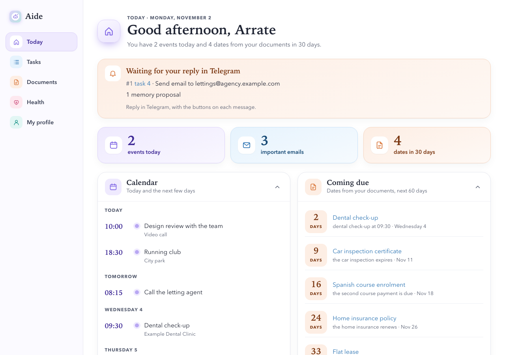 | 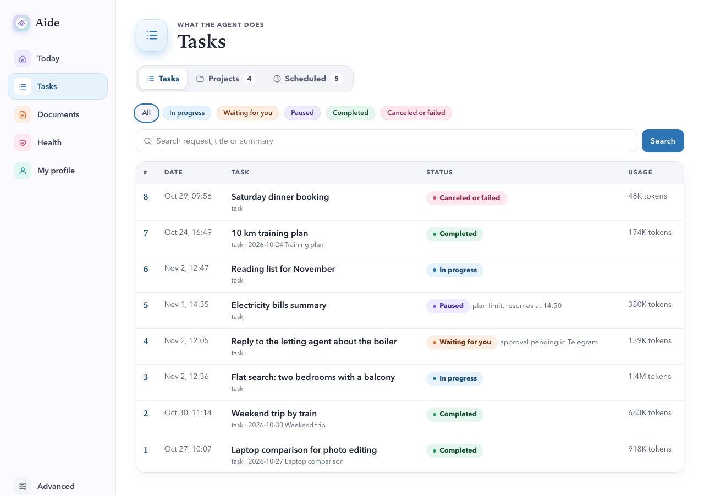 |
| **Tasks › Projects** | **Tasks › Scheduled** |
| 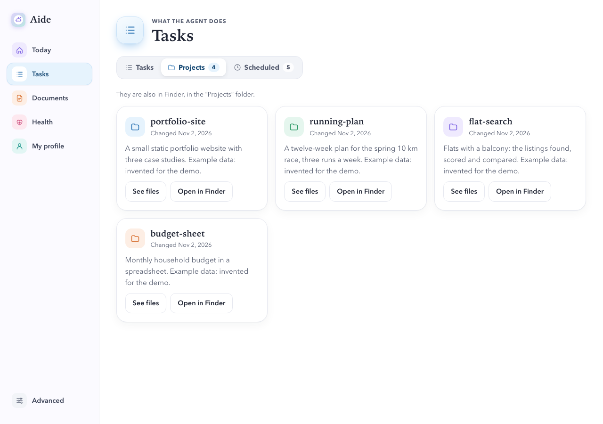 | 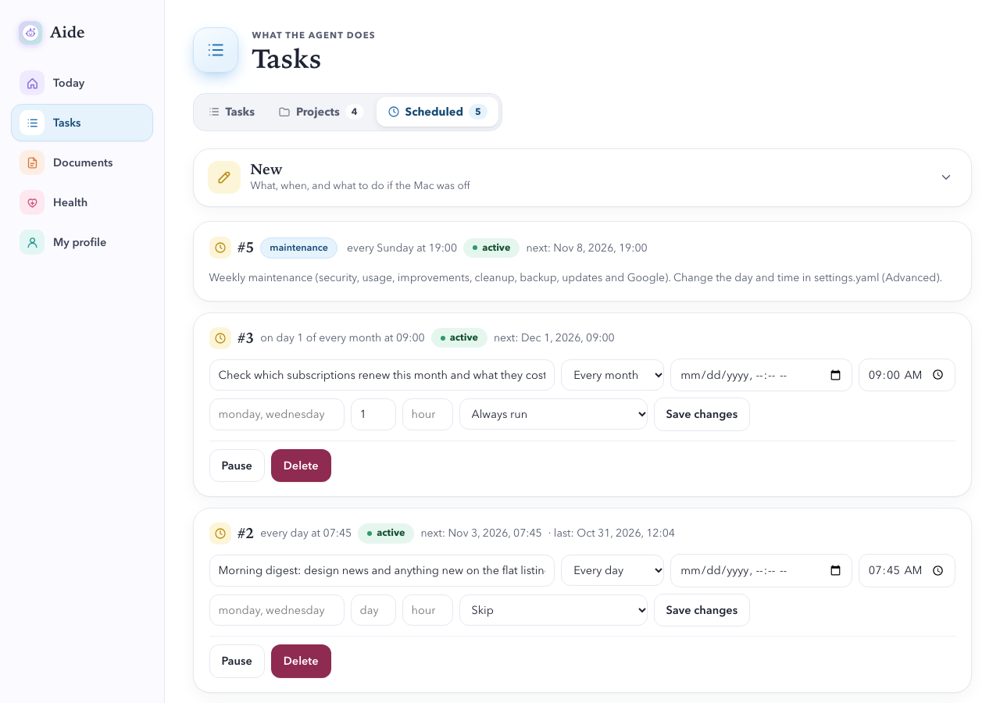 |
| **A task in progress** | **Documents** |
| 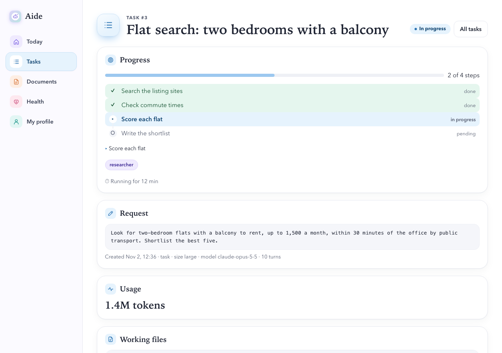 | 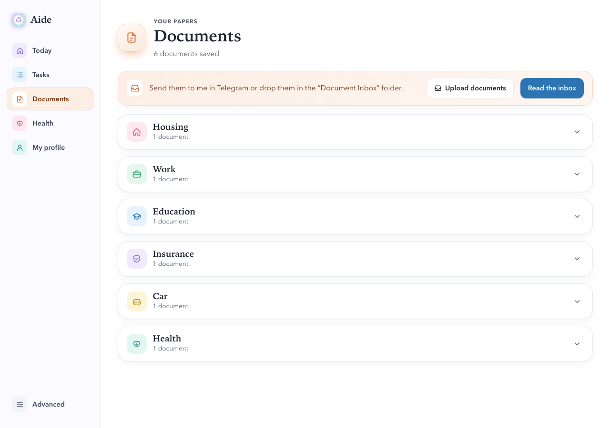 |
| **Health › Cycle** | **Health › Gym** |
| 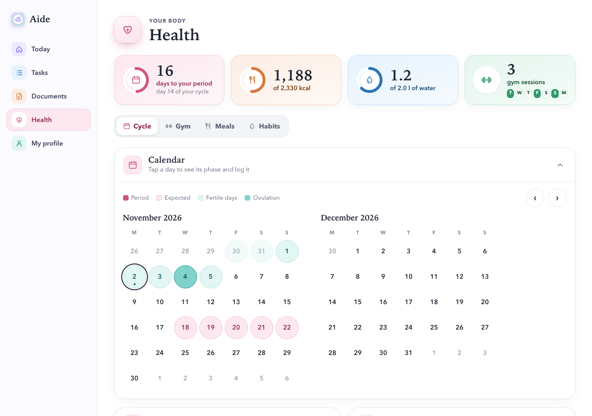 | 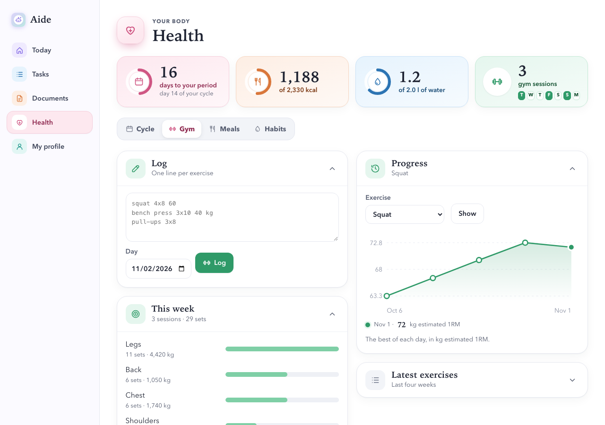 |
| **Health › Meals** | **Health › Habits** |
| 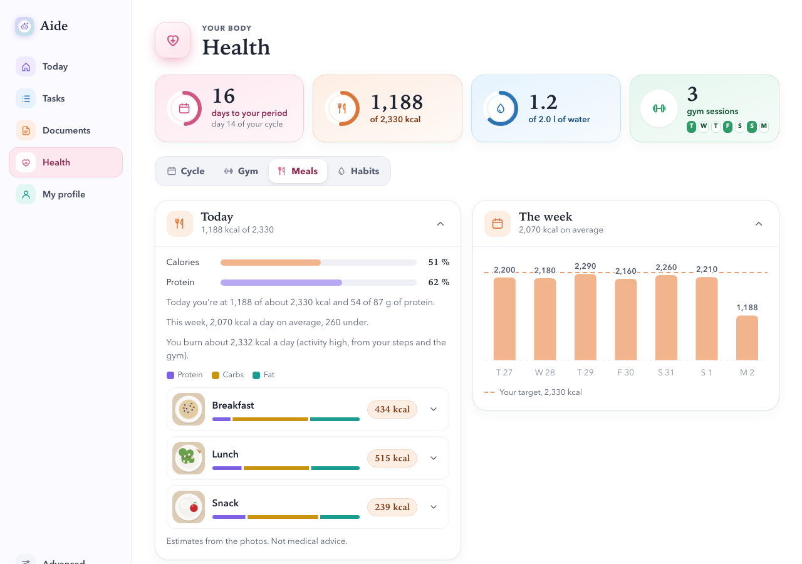 | 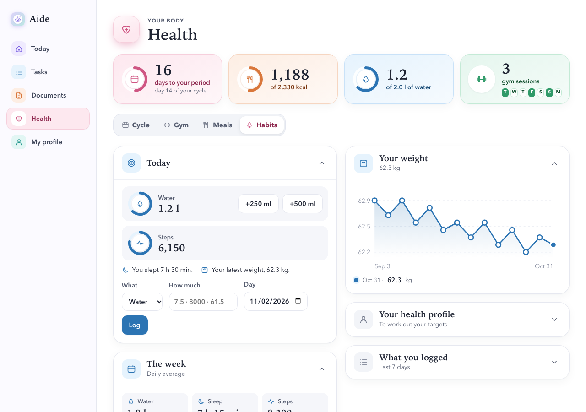 |
| **My profile** | **Email** |
| 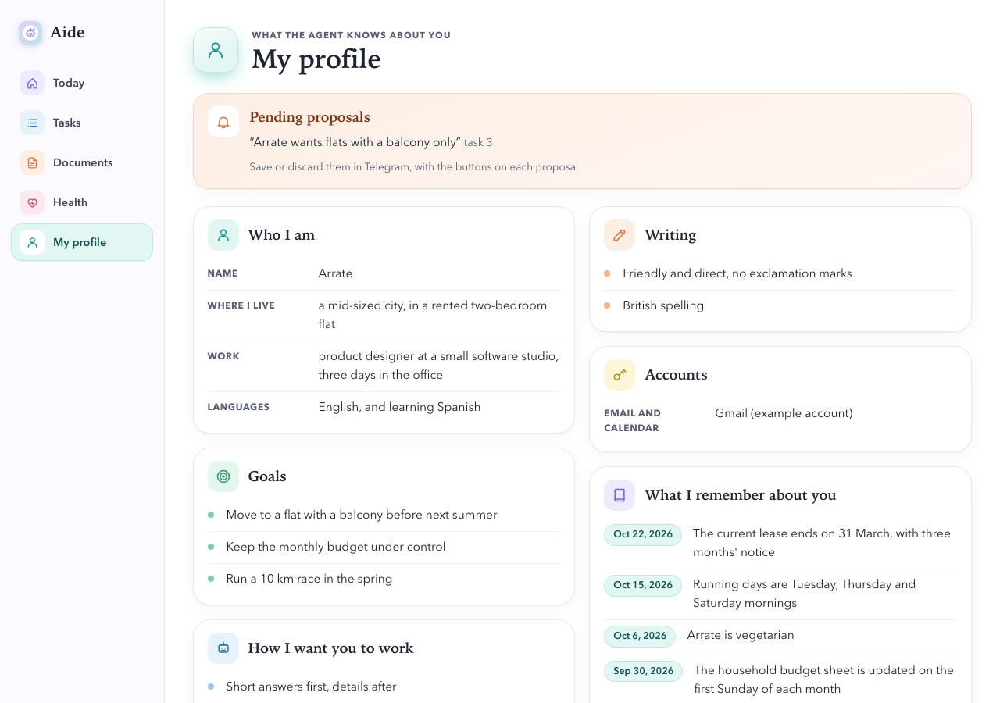 | 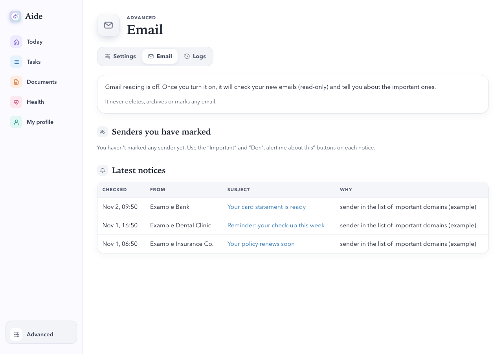 |

On a phone:

<p>
  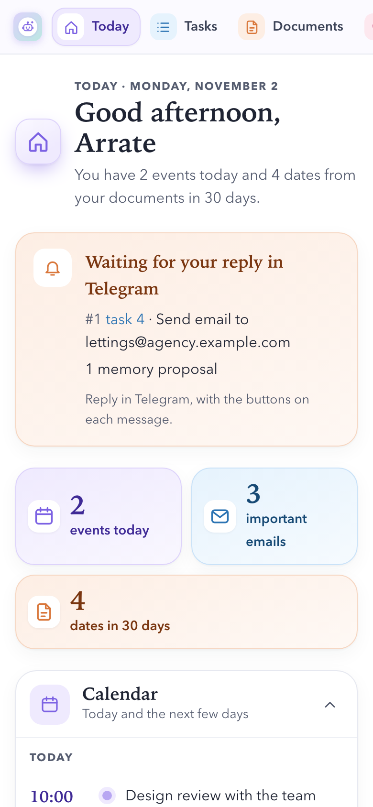
  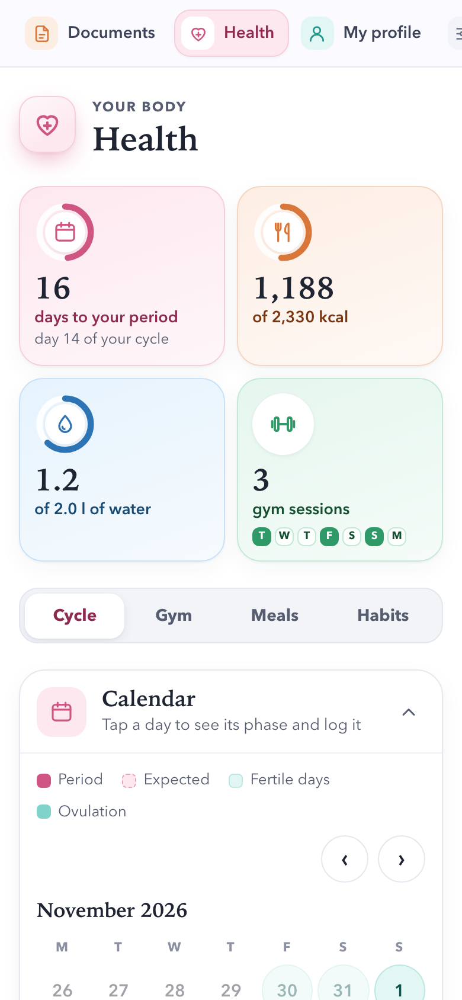
  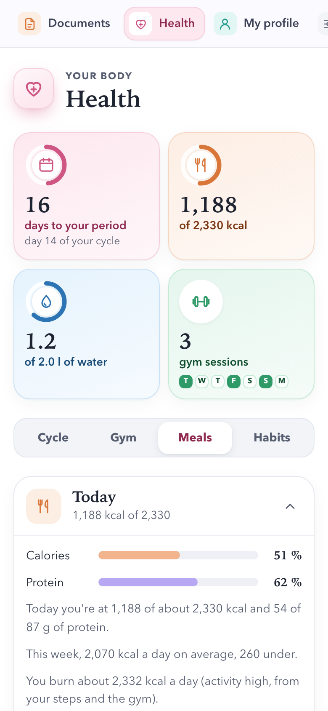
</p>

## Architecture

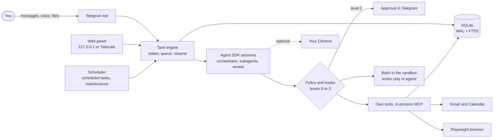

The engine (`core/engine.py` and its parts by topic, `core/engine_*.py`) owns every task: it moves it through an explicit state machine, stores each step in SQLite and resumes the SDK session after a crash, a restart or a plan limit. Every tool call goes through the same policy before it runs. External actions (an email, an event) carry an idempotency key, so a resumed task never sends the same thing twice.

| Module | What it does |
| --- | --- |
| `src/aide/core/` | Engine, task states, SDK sessions and subagents, policy, hooks, approvals, triage, scheduler, usage, database |
| `src/aide/bot/` | Telegram channel, commands, formatting and voice notes (transcribed locally with Whisper) |
| `src/aide/tools/` | The agent's own tools: Gmail, Calendar, memory, history, browser, documents, scheduling |
| `src/aide/panel/` | FastAPI panel (with its Health section), Jinja templates, CSS and a small script for live updates, tabs and chart tooltips |
| `src/aide/paperwork/` | Documents: reading, dates, reminders, inbox folder and duplicates |
| `src/aide/email/` | The email filter: rules first, the model only for what the rules can't decide |
| `src/aide/health/` | Health: cycle estimate and reminder, gym parser with records, meals by photo, habits, targets and the weekly summary |
| `src/aide/maintenance/` | Weekly report: security, usage, cleanup, backup, updates and improvement proposals |
| `src/aide/common/` | Configuration, paths, environment cleanup, logging and the API key helper |
| `config/` | `settings.yaml` (settings), `models.yaml` (models per role), `permissions.yaml` (the policy) |
| `agent/` | The agent's working folder and `CLAUDE.md`, the instructions file the SDK loads |
| `tests/` | Tests, with a fake SDK client and a fake Google |

## Telegram commands

| Command | What it does |
| --- | --- |
| `/status`, `/tasks`, `/task N` | What is running, the last tasks, one task in detail |
| `/stop N`, `/pause N`, `/resume N` | Cancel, pause or resume a task |
| `/plan text` | A task that shows its plan first |
| `/opus`, `/sonnet`, `/max` | The model for the next task |
| `/usage` | Plan limits and usage per task |
| `/memory`, `/forget text`, `/profile` | The memory and your profile |
| `/schedule text`, `/scheduled` | Schedule a task, list the scheduled ones |
| `/documents` | Read the new documents in the inbox folder |
| `/period` | Your cycle; `/period today`, `/period yesterday`, `/period 24-10` (day first) or `/period end` to log it |
| `/gym` | Your week at the gym; or just send lines like `squat 4x8 60` or `bench press 3x10 40 kg` |
| `/meals`, `/meals week` | What you ate today or in the last 7 days |
| `/water`, `/sleep`, `/steps`, `/weight` | Log a habit: `/water 500`, `/sleep 23:30-7:00`, `/steps 8000`, `/weight 61.5` |
| `/health`, `/health profile` | Your day against your targets, and your health profile |
| `/panel`, `/google` | The panel link, renew the Google authorization |

Exercise names are matched against a list with synonyms in several languages, and anything unknown is asked about with buttons. A meal photo without a caption gets an "It's food" button.

**About the health numbers.** The cycle, fertile window and calorie figures are rough estimates calculated from what you log. They are not medical advice and must not be used as contraception.

## Security model

- **Approvals.** Every tool call gets a level: 0 runs, 1 runs and notifies you, 2 waits for your approval in Telegram with the exact details, 3 is blocked. Decisions are only taken in Telegram; the panel can show them but has no buttons or routes to decide them.
- **Policy as code.** The levels come from `config/permissions.yaml` and `core/policy.py`, evaluated in a `PreToolUse` hook and in `can_use_tool`. Paths are normalized before they are checked, Bash commands are parsed (also inside `bash -c`, `eval` and substitutions), and secrets, `config/`, `src/` and your data are off limits. The agent can't edit the policy, and the weekly report asks you to approve any change to it.
- **Sandbox.** Bash runs in Claude Code's sandbox (Seatbelt on macOS) with unsandboxed commands turned off: commands can only write inside `agent/`, can't read the secret paths and only reach the allowed domains.
- **The panel** listens on `127.0.0.1` only, checks the `Host` and `Origin` headers, uses a token from the keychain, an HttpOnly SameSite=Strict cookie, CSRF tokens and a strict content security policy. From a phone it can be reached through `tailscale serve` inside your tailnet, never with Funnel: if Funnel is on, or its state can't be read, the panel refuses the Tailscale address.
- **Secrets.** The Google token, the panel token and the Claude API key live in the macOS keychain. `.env` (Telegram token) is `chmod 600` and unreadable for the agent. Logs redact anything that looks like a token.
- **Health data.** The cycle, gym, meals, habits and health profile live in their own tables and the meal photos in `data/health/`, which the policy and the sandbox keep out of the agent's reach. No agent tool reads them, they never go to triage or memory, and the model only sees a meal photo (or, to correct it, the list of foods), with a small output cap and without saving the conversation.
- **Untrusted content.** Web pages, emails and documents are treated as data. Text in them that looks like instructions is detected by code, and the session and any approval it leads to are marked so you can see it.
- **Tests never call the model.** A fixture blocks any real SDK connection, and the suite runs offline.

## Claude account

The Agent SDK documentation says how an application built with it should authenticate: with a Claude Console API key, or through Amazon Bedrock, Google Cloud or Microsoft Foundry. It also says: "Unless previously approved, Anthropic does not allow third party developers to offer claude.ai login or rate limits for their products, including agents built on the Claude Agent SDK" ([Agent SDK overview](https://code.claude.com/docs/en/agent-sdk/overview), [Quickstart](https://code.claude.com/docs/en/agent-sdk/quickstart)).

So Aide uses an API key by default (`claude.credential: api_key` in `config/settings.yaml`):

1. Create an API key in the [Claude Console](https://platform.claude.com/).
2. Save it in the macOS keychain: `uv run aide --set-api-key` (it asks for it without showing it). An `ANTHROPIC_API_KEY` in `.env` or in the environment, the form the quickstart uses, is also accepted: at startup it is moved to the keychain and removed from the environment.
3. Claude Code gets the key through the [`apiKeyHelper`](https://code.claude.com/docs/en/settings-reference#apikeyhelper) setting, which runs a command and uses its output ([Authentication](https://code.claude.com/docs/en/authentication#credential-management)). The command is `python -I -m aide.common.api_key`, which reads the keychain, refuses to run inside the sandbox where the agent's commands run, and is blocked by the policy. The key is never in the environment of the agent's sessions, so a command like `env` can't print it.

The startup check (`uv run aide --check`) and the weekly report confirm that the session takes the key from the helper and that no Anthropic credential is left in the environment, `.env` or the LaunchAgent.

The other option, `claude.credential: login`, uses Claude Code's `/login` on the Mac. Keep it for your own personal use, in line with the note above. It is also the only way to use your real Chrome, because Claude in Chrome needs a claude.ai sign-in ([Chrome integration](https://code.claude.com/docs/en/chrome)). Bedrock, Google Cloud and Foundry are not wired in: their variables are removed from the environment at startup.

## Requirements

- macOS (the sandbox, the keychain and the LaunchAgent are macOS-specific) on Apple silicon for local voice transcription
- Python 3.13 and [uv](https://docs.astral.sh/uv/)
- A Claude Console API key (see above)
- A Telegram bot, created with [@BotFather](https://t.me/BotFather), and your numeric Telegram user id
- Optional: a Google Cloud OAuth client for Gmail and Calendar
- Optional: Google Chrome with the Claude in Chrome extension, with `claude.credential: login`

## Installation

```sh
git clone https://github.com/arratenogales-ai/aide.git
cd aide
uv sync
uv run playwright install chromium   # the browser the agent uses to read web pages

cp .env.example .env
chmod 600 .env
```

Edit `.env`:

- `USER_NAME`: your name; the bot and the panel call you by it.
- `TELEGRAM_BOT_TOKEN` and `TELEGRAM_ALLOWED_USER_ID`: the bot only answers that user.
- Optional: `GOOGLE_ACCOUNT` (the Gmail account you will authorize) and `PANEL_TAILSCALE` (your Mac's `x.y.ts.net` name).

Then:

```sh
uv run aide --set-api-key   # saves the Claude API key in the keychain
uv run aide --check         # checks the environment and the sign-in
./deploy/install.sh          # installs and starts the LaunchAgent
```

`deploy/install.sh` runs the check again, writes `~/Library/LaunchAgents/com.aide.agent.plist` with this folder's paths and starts it; the agent then starts when you log in and restarts if it crashes. `deploy/uninstall.sh` removes it. To try it in a terminal instead, run `uv run aide`.

**Opening the panel.** Send `/panel` to your bot: it replies with a sign-in link for `http://127.0.0.1:8765` (and the Tailscale one, if set up). The link sets a session cookie that lasts 30 days.

**Google (optional).** Create an OAuth client of type "Desktop app" in Google Cloud with the Gmail and Calendar APIs enabled, save it as `config/credentials.json`, set `GOOGLE_ACCOUNT` and send `/google` to the bot. The agent asks only for `gmail.readonly`, `gmail.compose` and `calendar.events`, and refuses a token with more.

**Example data.** `uv run python scripts/demo_data.py --serve` builds an invented week in `.tmp/demo` (tasks, projects, scheduled tasks, documents, email, calendar and health, with meal photos drawn by code) and opens the panel on it, on a free port with a random token. It asks which name to show, or takes it with `--name`, and uses Alex if you don't give one. It never touches your real data and doesn't connect to Telegram, Google or the model.

## Configuration

- `config/settings.yaml`: time zone, task budgets, the Claude credential, the real browser, voice, scheduler, weekly maintenance, sandbox domains, Google, the email filter, the morning summary and the offline mode.
- `config/models.yaml`: which model and effort each role uses (triage, orchestrator, subagents, review, maintenance, and `meals` for meal photos).
- `config/permissions.yaml`: the policy. The panel shows it but can't change it; edit it and restart.
- `.env`: the values that are personal or secret (see `.env.example`).

Settings and models can also be edited from the panel (Advanced), which validates them and keeps a copy of the previous version.

## Tests

```sh
uv run ruff check .
uv run ruff format --check .
uv run pytest
```

The suite uses a fake SDK client (`tests/fake_sdk.py`) and a fake Google, runs offline, and fails if anything tries to open a real model session. Before publishing a fork, `uv run python scripts/check_publish.py` looks for tokens, real email addresses, personal paths, private files and image metadata in everything `.gitignore` would let through.

## Limitations

- It only runs on macOS on Apple silicon, because the sandbox, the keychain, the LaunchAgent and local voice transcription depend on it.
- It is made for one person: the bot only answers one Telegram user.
- Its health figures are rough estimates, not medical advice.
- The detector for instructions hidden in web pages, emails and documents works by patterns and can be evaded. That is why it only marks them: what protects you is that sensitive actions still need your approval.
- The tests never call the model, so they don't cover how the model actually behaves. That part is tested by hand.

## Language

The interface, the code and the documentation are in English. Spanish only remains where it is data: the lists that also understand what the user writes in Spanish, such as weekdays, meal names or “usa Chrome”.

## License

[MIT](LICENSE)
